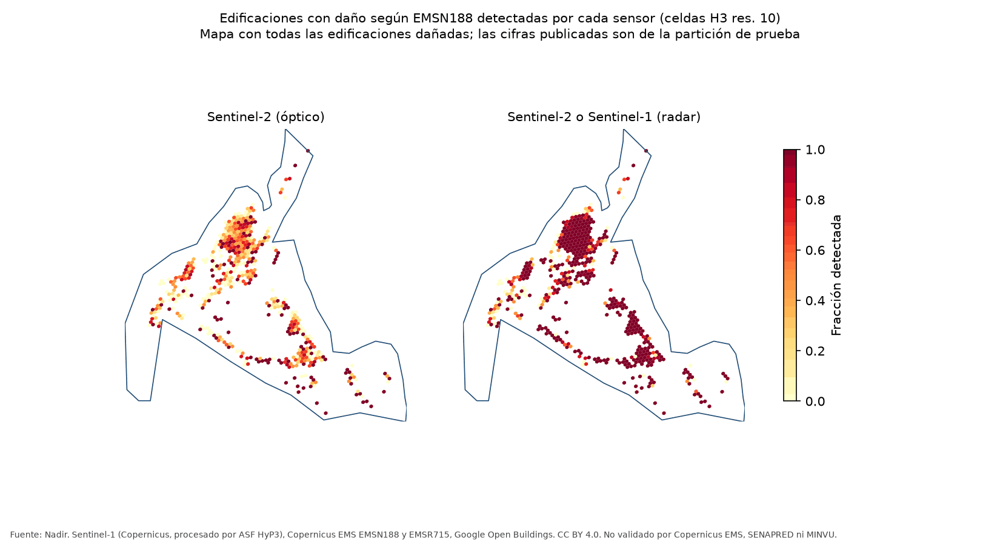
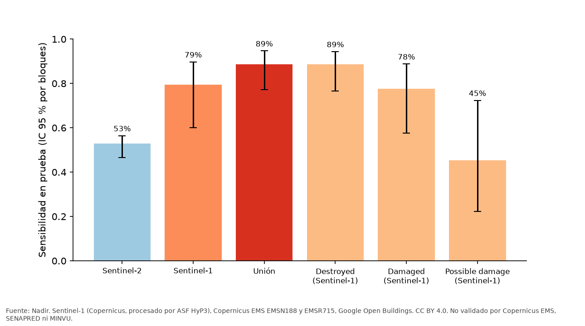

*Leer en español: [README.md](README.md)*

# Building damage in the Viña del Mar fire, February 2024

The fire of 2 and 3 February 2024 destroyed thousands of homes in Viña del Mar and Quilpué. The
Sentinel-2 optical satellite measures burnt vegetation well, but on the populated hills it misses a
large share of the damaged houses: roofs without vegetation, 20 m pixels that mix house, street and
yard. This repository answers one question: **how much of that damage does the Sentinel-1 radar see,
independently of vegetation and clouds, and how much does it add to the optical sensor?**

The signal is the **loss of interferometric coherence**: when a house collapses or loses its roof, it
stops returning the same signal to the radar between two passes. Everything is computed with free and
open data and validated against the official reference of the Copernicus Emergency Management Service.

Part of [Nadir](https://nadir-observatorio.github.io/), Wildfires line. Sister case:
[burn severity with Sentinel-2](https://github.com/Nadir-Observatorio/incendios-severidad).

<!-- The figures in this file are written by scripts/escribir_readme.py from resultados/resumen_sitio.json; do not edit them by hand. -->

## Results

Test partition, evaluated **once** with the threshold fixed on the tuning partition. 95 % intervals
by spatial block resampling. Reference: Copernicus EMSN188 damage points matched to Google Open
Buildings footprints.

| Question | Result |
|---|---|
| Share of damaged buildings detected by the radar | **79.4%** [59.9, 89.7] |
| ... destroyed | 88.6% [76.5, 94.4] |
| ... damaged | 77.7% [57.6, 88.8] |
| ... possibly damaged | 45.3% [22.2, 72.4] |
| Optical (Sentinel-2) on the same buildings | 53.0% [46.6, 56.4] |
| Both together | **88.7%** [77.1, 94.7] |
| What the radar adds to the optical sensor | 35.8 percentage points [28.1, 40.1] |
| Of what the optical sensor missed, share recovered by the radar | 76.1% [55.7, 88.0] |
| False alarms on buildings with no recorded damage (EMSN188 area) | 4.3% [3.0, 6.0] |
| False alarms far from the fire (over 2 km from the EMSR715 burnt area) | 1.3% [1.0, 1.6] |
| Precision of the radar detections | 62.5% [44.9, 71.3] |
| Area under the ROC curve | 0.94 [0.89, 0.97] |
| Ascending orbit only / descending only | 65.0% / 71.3% |
| With footprints of confidence ≥ 0.65 (robustness) | 77.9% [59.1, 89.2] |

**Outside the affected zone, the radar does not invent a damage area.** Outside the area analysed by
EMSN188, 40 of 8,763 H3 resolution 10 cells exceed the threshold; of these, the
ones touching the official EMSR715 burnt area number 1. They are scattered cells in the city (works,
urban change), not an omitted damage zone.

**Relation with the severity case.** The optical figure in this table uses the broadest rule of the
severity case (all burnt classes), the same one that case used to measure its omission in the urban
interface against EMSN188, on a sample of points: both measurements agree. With that case's
calibrated threshold the optical sensor would see even less urban damage, so the comparison favours
the optical sensor.

## How to read it

- **"Probable damage according to radar"**, not "destroyed house". The radar measures that something
  changed, not what changed: debris removal and emergency works also lower the coherence.
- The signal is 20 m: per building it is a signal of its surroundings. Public results are given per H3
  cell, never per dwelling.
- EMSN188 is an official photo-interpretation on a post-event image, not ground truth; buildings
  without a point are "no recorded damage", not "no damage".
- **Copernicus EMS, SENAPRED and MINVU have not validated these results.**

## Method

1. **Sentinel-1A pairs** (the only satellite operating in February 2024): per orbit, six 12-day
   pre-event pairs, the event pair and one post-event pair. Ascending, orbit 18, 20:28 Chile time,
   event from 23-01 to 04-02-2024. Descending, orbit 156, 07:04 Chile time, event from 02-02 to
   14-02-2024 (the 2 February pass precedes the fire). 56 coherence products at 20 m ordered from
   [ASF HyP3](https://hyp3-docs.asf.alaska.edu/) (`INSAR_ISCE_BURST`, 5x1 looks).
2. **Per-pixel signal:** `z = (m − c_event) / max(s, 0.05)`, with `m` and `s` the mean and deviation
   of the pre-event coherence; common 20 m grid in UTM 19S; layover and shadow mask from each
   product's geometry.
3. **Per building:** mean weighted by the exact area of the footprint buffered by 10 m; combined
   signal = mean of both orbits.
4. **Reference:** each EMSN188 P08 damage point is matched to the footprint that contains it or to the
   nearest within 10 m (2.3% of the 7,275 points had no footprint).
5. **Partition:** H3 resolution 8 blocks, stratified, half tuning and half test, written to disk with
   its hash before any signal was read.
6. **Threshold:** 90th percentile of the signal on tuning buildings with no recorded damage
   (z = 1.49).

Protocol sealed before any data was ordered, and two amendments written before any signal was read,
in [`protocolo/`](protocolo/) (Spanish), with their sha256 hashes.

## Reproduce

Requirements: Python 3.12, a free [Earthdata Login](https://urs.earthdata.nasa.gov/) account and
about 15 GB of free space. Commands and arguments are listed in the Spanish README; each task checks
the sha256 hashes of the protocol, amendments, references and every product before computing. Exact
pairs: [`resultados/pares_hyp3.json`](resultados/pares_hyp3.json). The Copernicus EMS references are
downloaded from their pages ([EMSN188](https://riskandrecovery.emergency.copernicus.eu/EMSN188),
[EMSR715](https://rapidmapping.emergency.copernicus.eu/EMSR715)) and are not redistributed here.

Tests and quality: `pytest`, `ruff check scripts tests`, `mypy`.

## Limitations

- A single satellite: the event pair spans 12 days and includes the first works.
- A burnt house with its structure standing may keep its coherence.
- Damage concentrates in few blocks, so the sensitivity interval is wide; the advantage of combining
  both sensors over the optical one alone is firmer.
- The threshold was set for 10 % false alarms on tuning and gave fewer on test: buildings without
  damage differ in space between partitions.
- No radar amplitude: the products do not provide it per date (amendment 02).

## Data and licences

Code: MIT ([`LICENSE`](LICENSE)). Results and figures: CC BY 4.0, with the notices in
[`LICENSE-DATA.md`](LICENSE-DATA.md).

Made by Camilo López Barra, geographer.
